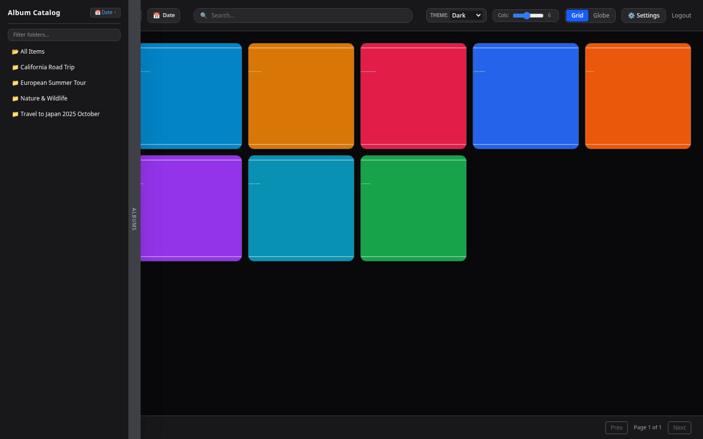
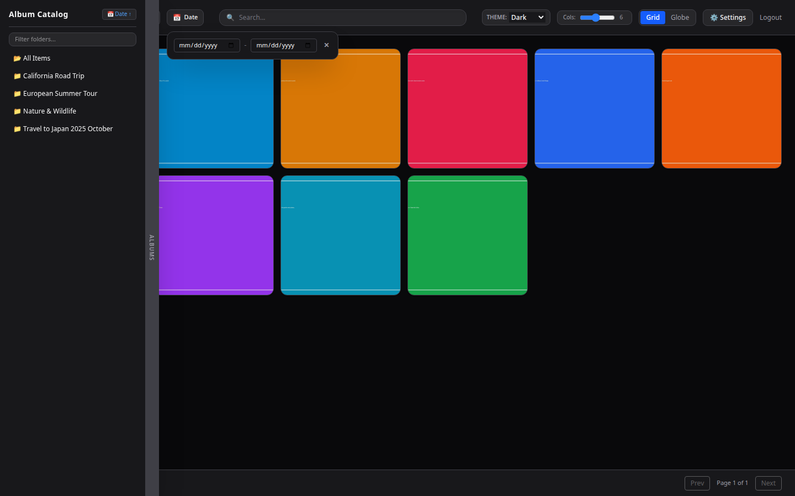
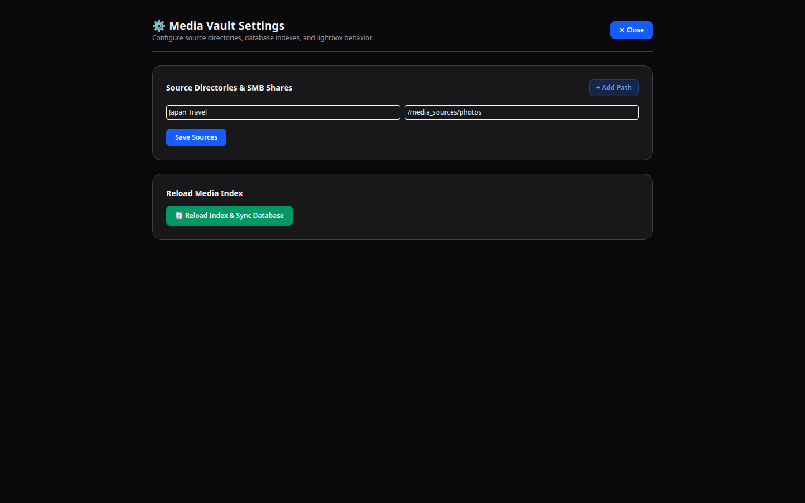
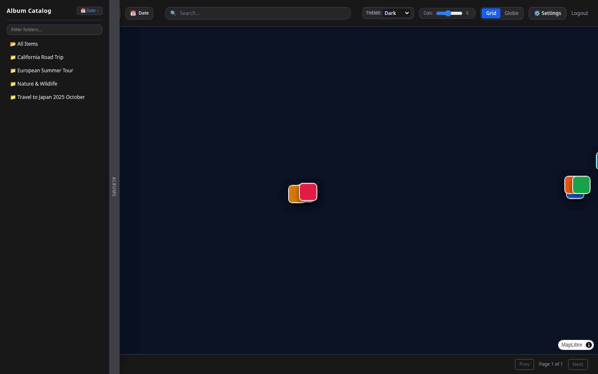
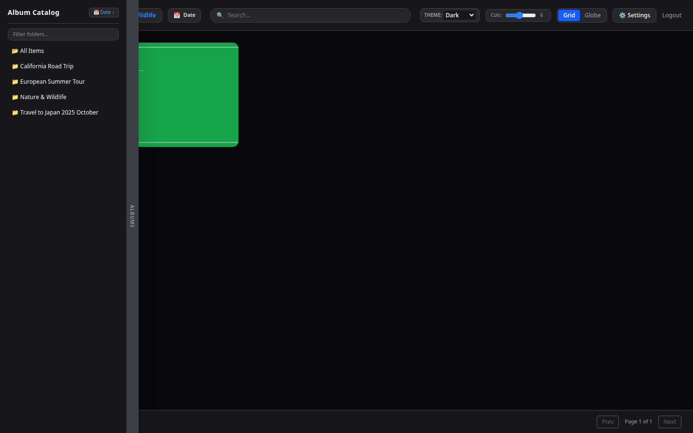
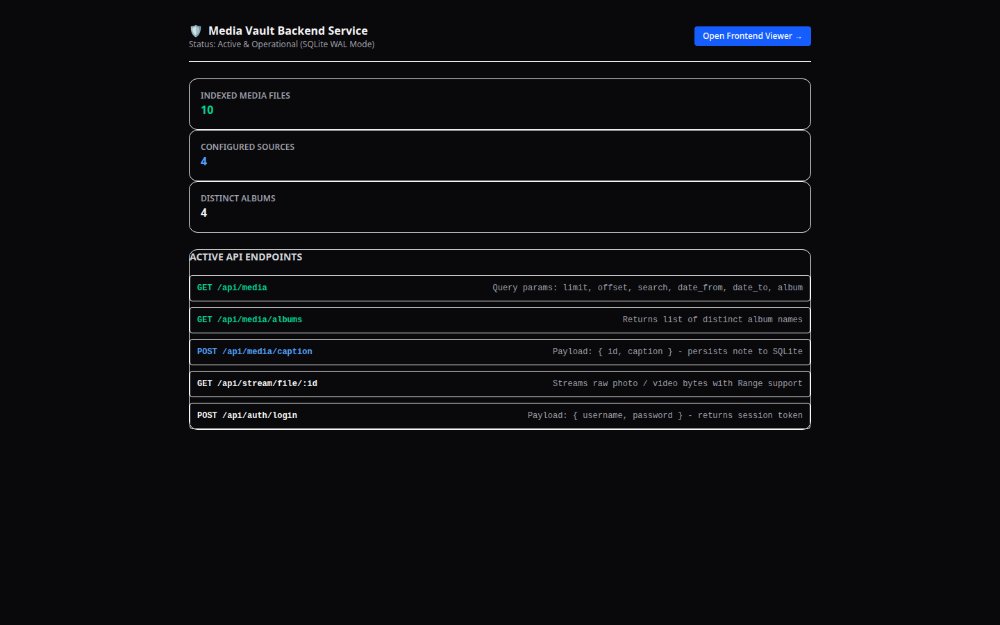

# Media Vault: Self-Hosted Local Photo & Video Web Viewer

A self-hosted, browser-based media vault engineered to index and browse local photos and video shares. Features virtualized grid rendering, multi-theme styling, dynamic PhotoSwipe dynamic-caption inspection, interactive MapLibre 3D globe visualization via EXIF coordinates, and automated background media synchronization to an embedded SQLite database.

---

## 1. System Overview & Architecture

```
                       +-----------------------------+
                       |   sources_config.json       |
                       | (Folder paths, tags, names) |
                       +--------------+--------------+
                                      |
                                      v
+-----------------------------------------------------------------------------------+
| BACKEND SERVICE (Rust: Axum + Tokio / SQLite WAL)                                 |
|                                                                                   |
|  +--------------------+    File Hashes/mtime     +------------------------------+ |
|  | File Watcher /     | -----------------------> | Embedded SQLite              | |
|  | Background Scanner |                          | (Indexed EXIF, Timestamps,   | |
|  +---------+----------+                          |  Geo coordinates, Captions)  | |
|            |                                     +--------------+---------------+ |
|            v                                                    |                 |
|  +--------------------+                                         |                 |
|  | Pipeline:          |                                         | Fast queries    |
|  | fast_image_resize  |                                         v (<5ms)          |
|  | -> ThumbHash/WebP  |                                  +--------------+         |
|  | -> FFmpeg Stream   |                                  | Axum REST /  |         |
|  +--------------------+                                  | JSON / Bytes |         |
+----------------------------------------------------------+-------+------+---------+
                                                                   |
                      +--------------------------------------------+
                      | HTTP Range streaming (206) / Virtualized payloads
                      v
+-----------------------------------------------------------------------------------+
| FRONTEND SPA CLIENT (Tailwind CSS + MapLibre GL 3D Globe + PhotoSwipe 5)          |
|                                                                                   |
|  +--------------------------------+       +-------------------------------------+ |
|  | Filter & Navigation Engine     |       | 3D Globe & Map Engine               | |
|  | (Album / Date Range / Search)  |       | (MapLibre GL Globe Projection)      | |
|  +---------------+----------------+       +------------------+------------------+ |
|                  |                                           |                    |
|                  v                                           v                    |
|  +--------------------------------+       +-------------------------------------+ |
|  | Responsive Media Grid          |       | Image-Based Pin Anchors             | |
|  | (Zoom Slider 3-10 Cols / Page) |       | (Click to open PhotoSwipe Lightbox) | |
|  +--------------------------------+       +-------------------------------------+ |
+-----------------------------------------------------------------------------------+
```

### Key Technical Pillars
* **Frontend Runtime:** Vanilla JavaScript (ES Modules), Tailwind CSS, PhotoSwipe 5, and MapLibre GL JS (Globe projection).
* **Backend Runtime:** Rust (Axum, Tokio async runtime).
* **Database & Persistence:** SQLite3 running in WAL (`Write-Ahead Logging`) mode.
* **Media Processing & Streaming:** `nom-exif` for metadata extraction, `ffmpeg` on-the-fly range-request streaming (`206 Partial Content`) for high-resolution video.
* **Deployment Pattern:** Containerized single-binary runtime with multi-stage Docker build and Docker Compose persistence.

---


---

## Visual Previews & Screenshots

| 1. Virtualized Gallery Grid | 2. Collapsible Date Range Filter |
| :---: | :---: |
|  |  |

| 3. Source Folder Configuration | 4. Interactive 3D Globe Viewer |
| :---: | :---: |
|  |  |

| 5. PhotoSwipe Lightbox & Dynamic Caption Editor | 6. Backend Diagnostics Dashboard |
| :---: | :---: |
|  |  |

## 2. Repository File Layout

```text
media-vault/
├── Cargo.toml                # Rust dependencies & build specifications
├── Dockerfile                # Multi-stage container build with FFmpeg & SQLite
├── docker-compose.yml        # Service orchestration & volume bind mounts
├── README.md                 # Project documentation
├── dist/
│   └── index.html            # Complete Single-Page Application (HTML/CSS/JS)
├── src/
│   └── main.rs               # Rust Axum backend server, API, and file watcher
└── data/                     # Host mount directory for SQLite database & logs
```

---

## 3. Database Schema

Execute or inspect the embedded SQLite database initialization:

```sql
PRAGMA journal_mode = WAL;
PRAGMA synchronous = NORMAL;

-- User Authentication
CREATE TABLE IF NOT EXISTS users (
    id INTEGER PRIMARY KEY AUTOINCREMENT,
    username TEXT NOT NULL UNIQUE,
    password_hash TEXT NOT NULL,
    created_at DATETIME DEFAULT CURRENT_TIMESTAMP
);

-- Album & Folder Sources Configuration
CREATE TABLE IF NOT EXISTS sources_config (
    id INTEGER PRIMARY KEY AUTOINCREMENT,
    album_name TEXT NOT NULL,
    path_location TEXT NOT NULL UNIQUE,
    tags TEXT,
    last_synced DATETIME
);

-- Media Assets Metadata
CREATE TABLE IF NOT EXISTS media (
    id INTEGER PRIMARY KEY AUTOINCREMENT,
    source_id INTEGER REFERENCES sources_config(id) ON DELETE CASCADE,
    album_name TEXT,
    file_path TEXT NOT NULL UNIQUE,
    file_type TEXT NOT NULL,       -- 'image' | 'video'
    date_taken TEXT,                -- ISO 8601 (YYYY-MM-DDTHH:MM:SS)
    year INTEGER,
    month INTEGER,
    day INTEGER,
    latitude REAL,
    longitude REAL,
    caption TEXT DEFAULT '',        -- Editable multiline caption
    thumb_hash TEXT,
    tags TEXT,
    indexed_at DATETIME DEFAULT CURRENT_TIMESTAMP
);

-- Virtual Sharing Albums
CREATE TABLE IF NOT EXISTS sharing_albums (
    id INTEGER PRIMARY KEY AUTOINCREMENT,
    share_token TEXT NOT NULL UNIQUE,
    passcode TEXT NOT NULL,        -- 4-digit auto-generated numeric passcode
    album_name TEXT NOT NULL,
    media_ids TEXT NOT NULL,       -- JSON array of selected media IDs
    created_at DATETIME DEFAULT CURRENT_TIMESTAMP
);

-- Indexes for performance
CREATE INDEX IF NOT EXISTS idx_media_date ON media(date_taken);
CREATE INDEX IF NOT EXISTS idx_media_album ON media(album_name);
CREATE INDEX IF NOT EXISTS idx_media_geo ON media(latitude, longitude) WHERE latitude IS NOT NULL;
```

---

## 4. Setup & Deployment Instructions

### Prerequisites
* [Docker](https://docs.docker.com/get-docker/) installed.
* [Docker Compose](https://docs.docker.com/compose/install/) (v2.0+) installed.
* Local directory of photos/videos accessible to your machine.

---

### Step 1: Clone and Set Up Workspace
Create the project folder structure on your host machine:

```bash
mkdir -p media-vault/src media-vault/dist media-vault/data
cd media-vault
```

---

### Step 2: Configure Environment & Mounts

Open `docker-compose.yml` and adapt your host storage paths:

```yaml
version: '3.8'

services:
  media_vault:
    build: .
    container_name: media_vault
    ports:
      - "8080:8080"
    volumes:
      # Persistent SQLite DB and archived activity logs
      - ./data:/data
      # Read-only bind mounts to your local photo/video storage folders
      - /mnt/storage/photos:/media_sources/photos:ro
      - /mnt/storage/videos:/media_sources/videos:ro
    environment:
      - RUST_LOG=info
    restart: unless-stopped
```

---

### Option A: Instant Local Deployment (Python Standalone)

Run the zero-dependency Python backend runner:

```bash
python3 server.py
```
Open [http://localhost:8080](http://localhost:8080) for the frontend viewer or [http://localhost:8080/admin](http://localhost:8080/admin) for backend diagnostics.

---

### Option B: Containerized Docker Deployment (Rust & SQLite)
### Step 3: Build & Launch with Docker

Run the multi-stage build and start the service in background mode:

```bash
docker compose up --build -d
```

Verify service operation:

```bash
docker compose ps
docker compose logs -f media_vault
```

---

### Step 4: First-Time Login & Source Sync

1. Open your browser and navigate to `http://localhost:8080`.
2. Sign in using the default administrative credentials:
   * **Username:** `admin`
   * **Password:** `admin`
3. Click **⚙️ Settings** (or **Manage Sources**) in the top navigation bar:
   * Add a source row pointing to your mounted container path (e.g., `/media_sources/photos` or SMB paths mapped into the container).
   * Click **Save Sources to Database**.
   * Click **🔄 Reload Index & Sync Database** to start the background scanner.
4. Press **F5** or close settings once notified to view indexed assets.

---

## 5. Feature Usage Guide

### Auto-Hiding Left Album Catalog
* Move your mouse to the far-left screen tab (`Albums`) to expand the sidebar catalog.
* Use the **Filter folders** input to quickly search albums.
* Click **📅 Date ↑ / 🔤 Name A-Z** to cycle sorting between Date Ascending, Date Descending, Alphabetical A-Z, or Z-A.
* Clicking any album shortcut will automatically reset global date filters and focus on that specific album.

### Responsive Search & Date Filters
* **Global Search Box:** Search for text across captions, city names, country names, or album titles. Search automatically overrides date constraints.
* **Collapsible Date Filter:** Click **📅 Date** to open the start/end date picker (defaults to January 1 – December 31 of the current calendar year).

### 3D Globe Viewer
* Switch from **Grid** to **Globe** in the top navigation bar.
* Photos containing valid EXIF GPS coordinates are rendered as interactive image pins on a 3D Earth sphere.
* Clicking any thumbnail marker opens the photo directly inside the lightbox.

### PhotoSwipe Dynamic Captions & Slideshow
* Click any photo or video tile to open the high-resolution lightbox.
* **Slideshow Control:** Click `▶` in the top bar to play an automated slideshow (advancing every 3 seconds); click `⏸` to pause.
* **Caption Window:** Click `💬` next to the play icon to reveal the bottom/aside caption overlay.
* **Edit Captions:** Click `✏️ Edit` to expand the multiline note editor and click **Save to SQLite** to persist changes immediately.

### Sharing Albums
* Click **🔗 Share** in the top navigation bar to enter batch-selection mode.
* Select desired photos and click **Generate**.
* The system will produce a virtual sharing link protected by an auto-generated 4-digit passcode.

### Activity Logs & Nightly Archival
* All access, updates, and indexing actions are recorded in `/data/logs/photoviewer-YYYY-MM-DD.log`.
* A background async worker compresses previous-day logs into `/data/logs/photoviewer-YYYY-MM-DD.zip` every midnight.
